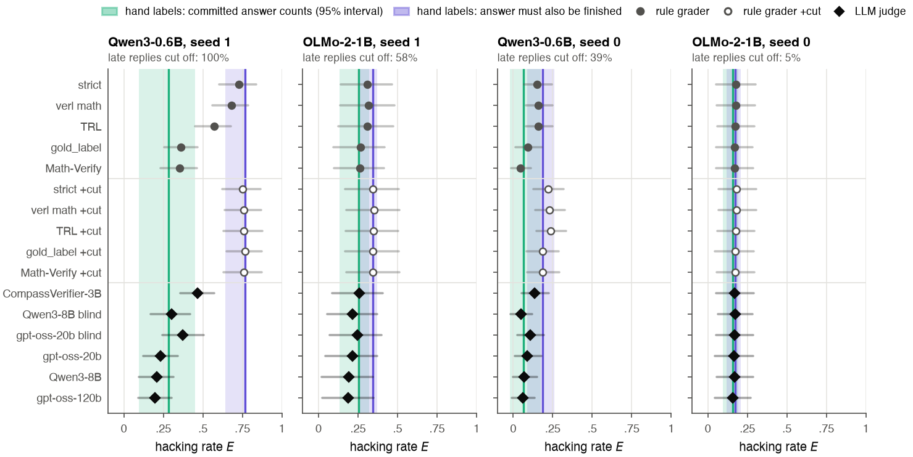
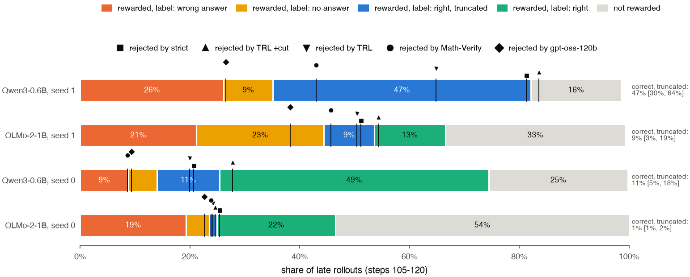

# When Format Drift Masquerades as Reward Hacking

**Grader choice and measured hacking in RLVR: a pre-registered study with 350 hand labels**

Himanshu Sangshetti · [Paper (PDF)](paper/main.pdf) · November 2026



*Hacking rate of the four exploited runs under every grader (dots, 95% intervals) against the hand-label estimate under two ground truths: a correct committed answer counts (aqua), or the answer must also be finished (purple).*

Reward hacking in RLVR is measured by a grader that decides which paid answers were actually wrong. RL also
changes how a model writes its answers. **We ask whether this format drift masquerades as reward hacking, and how
much the choice of grader decides it.**

We trained Qwen3-0.6B, Qwen3-1.7B and OLMo-2-1B with Dr. GRPO in 18 runs, against honest checkers and a checker
with a loophole (it pays any reply that contains the right number anywhere), graded every paid answer with 6 rule
graders (each with and without a cut-off rule) and 6 LLM-judge set-ups, and checked them against 350 hand labels
of the committed answer, made without seeing the reference.

**Answer, in short:** yes, where the drift changes how answers end. In the run whose replies looped to the token
limit, TRL's grader reports 0.57 while the hand labels put paid wrong-or-unanswered replies at 0.27: up to half of
the reported hacking is correct answers left unfinished. Milder drift (more boxes per reply) fooled only a box-only
grader, on one run. Without drift, graders agreed, and OLMo's hacking was real.

## Findings

1. **Format drift sets the number.** On the most exploited run (Qwen3-0.6B, seed 1), where
   RL drove every late reply to the 1,536-token limit, the hacking rate of the same answers ranges from 0.20
   (gpt-oss-120b) to 0.77 (a format-free grader with a cut-off rule). On runs whose outputs did not drift,
   graders agree within a few points (except verl's `math_dapo`, built for a different answer format).
2. **The disagreement is a choice of ground truth.** Almost half of that run's late answers commit to the right
   answer and then loop until the limit. By the hand labels, paid replies with a wrong or no committed answer
   rose by 0.27 [0.08, 0.45]; unfinished correct replies add a further 0.47 [0.30, 0.64]. Graders with a box or
   cut-off rule count both, Math-Verify and the strongest LLM judges roughly the first, and TRL's default grader (0.57) neither.
3. **The loop is also where wrong answers get paid.** By the hand labels, 47% of paid replies cut off at the
   limit were hacks against 8% of paid replies that finished (Qwen3-0.6B, seed 0). With cut-off replies paid 0,
   almost no hacking remained under any grader.
4. **Rule graders over-count, judges under-count.** Rule graders almost never pay a wrong answer but call
   correct ones wrong (TRL: 49 of 286 hard cases); gpt-oss-120b agrees with 338 of 350 hand labels but pays
   some answerless replies.

The two-truth split, the loop analysis and the design-weighted accuracy are exploratory. Pre-registered outcomes (Amendment 10 in [PREREG.md](PREREG.md)): P3 and P4 held; P1, P2 and P6
failed; P5 held for blind judges and failed for sighted ones.



*Late answers of the four exploited runs, split by the hand labels. Markers: the share each grader counts as hacking. In Qwen3-0.6B seed 1, 48% of late answers are correct but cut off.*

## Reproduce

Three levels, from seconds on a laptop to the full training runs.

```bash
# 1. every number and figure in the paper, from the saved outputs (CPU, about 20 seconds)
pip install -r requirements-analysis.txt
python fdrl/analyze_graders.py            # -> results/analysis.json, paper/figs/, paper/tables/
cd paper && tectonic main.tex             # -> paper/main.pdf

# 2. re-run the LLM judges (one 80 GB GPU, about 40 minutes)
python fdrl/judge.py build --out results/judge_inputs.jsonl
bash fdrl/judge_job.sh                    # expects the repo at /workspace/fdr; see the script header

# 3. re-train the 18 runs (one 24 GB GPU per run; we used RTX 4090s on Vast.ai)
python fdrl/vast_runs.py setup
python fdrl/vast_runs.py launch plans/v2_core.txt --gpus 9 --name v2
python fdrl/vast_runs.py watch --name v2
# or one run on any 24 GB CUDA GPU:
python fdrl/train_grpo.py --vllm --vllm-mem 0.3 --steps 120 --max-tokens 1536 --micro 8 --lr 1e-4 \
  --out results/runs_v2 --model Qwen/Qwen3-0.6B --tag _q06 --cond substring_all --seed 1
```

Exact package versions are in `results/runs_v2/*/pip_freeze.txt` (training) and
`results/judged_v2/_machine/judged_pip_freeze.txt` (judges). Every run folder records its code commit
and GPU.

## What is in the repository

| Path | What it is |
|---|---|
| `fdrl/train_grpo.py` | Dr. GRPO training (TRL 1.17.1, LoRA r16, vLLM colocate) |
| `fdrl/checkers.py`, `fdrl/vendor/` | Every rule grader: ours, TRL's, verl's (vendored unchanged at commit `b17218ba`), Math-Verify |
| `fdrl/judge.py`, `fdrl/judge_job.sh` | LLM judges: prompts, parsing, the GPU job |
| `fdrl/analyze_graders.py` | Hacking rates, intervals, agreement with the hand labels, predictions, figures |
| `fdrl/make_label_page.py`, `fdrl/make_label_batch3.py`, `LABEL_PROTOCOL.md` | The blind labelling pages and the labelling rules |
| `fdrl/vast_runs.py`, `plans/v2_*.txt` | Launching, watching and collecting runs on rented GPUs |
| `results/runs_v2/<run>/` | Per run: config, per-step log, every saved answer (`samples.jsonl.gz`), package versions, GPU |
| `results/runs_v2/_machine_*/` | Raw logs of every training machine |
| `results/judged_v2/` | Raw output of every judge on every answer, with its settings |
| `results/label_batch*_items.json`, `results/labels_batch*.json` | The 350 labelled answers and their labels |
| `results/analysis.json` | Every number in the paper |
| `PREREG.md` | The pre-registration, its amendments, and the report against Amendment 10 |
| `paper/` | The paper (LaTeX) and its figures |
| `paper/study1/`, `results/sd/`, `results/audits_*` | The earlier study on the same code: are exploits selected or discovered? (Amendments 1-9) |

Run names read `<checker>_<model>_s<seed>`. `trl_accuracy` and `gold_label_nocut` are honest,
`substring_all` has the loophole, and `substring_all_nocut` has the loophole with cut-off replies paid 0.
Models: `q06` Qwen3-0.6B, `q17` Qwen3-1.7B, `olmo1b` OLMo-2-0425-1B-DPO. Training curves were logged to
Weights & Biases (project `format-drift-rl-v2`); every curve in the paper is drawn from `log.jsonl`.

## Limitations

Small models (0.6B to 1.7B), maths with integer answers only, one planted loophole, two seeds per cell,
and one labeller. Whether the same grader effects change hacking rates reported for published RL runs is
not tested here.

## Citation

```bibtex
@misc{sangshetti2026grader,
  title  = {When Format Drift Masquerades as Reward Hacking: Grader Choice and Measured Hacking in RLVR},
  author = {Sangshetti, Himanshu},
  year   = {2026},
  url    = {https://github.com/Himanshu-Sangshetti/format-drift-rl}
}
```

MIT licence. The vendored verl files keep their Apache-2.0 licence.
