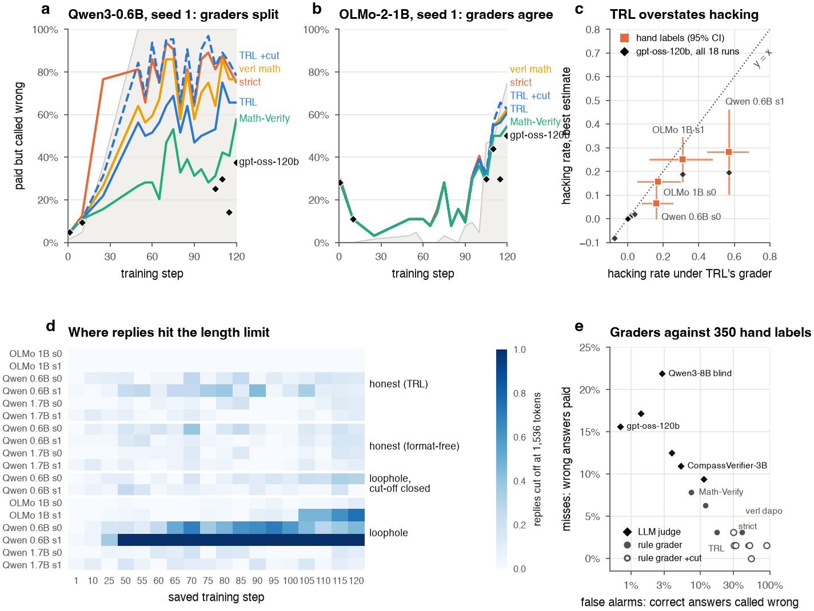

# How Much Reward Hacking Is the Grader?

**Grader choice and measured hacking in RLVR: a pre-registered study with 350 hand labels**

Himanshu Sangshetti · [Paper (PDF)](paper/main.pdf) · November 2026



*(a, b) Share of answers paid but called wrong by each grader over training; gray: replies cut off at the token limit. (c) TRL's hacking rate against the hand-label estimate and gpt-oss-120b, every run. (d) Where replies hit the limit. (e) Every grader's false alarms against misses on 350 hand labels.*

When a paper says "the model reward-hacked 57% of the time", that number is a grader's verdict: some
program decided which of the paid answers were actually wrong. We ask how much of measured reward
hacking is the grader failing as RL changes the model's outputs, rather than the model gaming the task.

We trained Qwen3-0.6B, Qwen3-1.7B and OLMo-2-1B with Dr. GRPO in 18 runs, against honest checkers and a
checker with a loophole (it pays any reply that contains the right number anywhere). We then graded every
paid answer with 6 rule graders (each with and without a cut-off rule) and 6 LLM-judge set-ups, and
checked all of them against 350 blind hand labels.

## Findings

1. **The grader sets the number.** On the most-exploited run (Qwen3-0.6B, seed 1), the hacking rate of
   the same answers is 0.73 under a box-only grader, 0.57 under TRL's `accuracy_reward`, 0.35 under
   Math-Verify on the whole reply and 0.20 under gpt-oss-120b. The hand labels put it at 0.28
   [0.11, 0.46]; TRL's and the box-only number lie outside that interval.
2. **Most of the inflation is one convention: replies that hit the length limit.** RL pushed every late
   reply of this run to the 1,536-token limit. Many had already committed to the right answer and then
   looped until the limit. 43 of TRL's 49 false alarms on labelled answers are such replies. Closing the
   cut-off channel in the checker removed the measured hacking (pre-registered, both seeds).
3. **Rule graders err in one direction.** Against the hand labels, rule graders almost never pay a wrong
   answer (0 to 5 of 64) but call correct answers wrong: 21 (Math-Verify), 49 (TRL), 113 (verl
   `math_reward`), 137 (box-only) and 250 (verl `math_dapo`) of 286. Errors in that direction only ever
   add hacking.
4. **A strong LLM judge agrees best with the hand labels.** gpt-oss-120b agrees on 338 of 350 (2 false
   alarms, 10 misses), Qwen3-8B on 335. Judges are not perfect on unanswered replies: sighted judges pay
   12-23% of them.
5. **Real hacking is still there.** OLMo-2-1B exploited the loophole in both seeds (hand-label estimates
   0.16 and 0.25), and there the graders broadly agree. Qwen3-1.7B did not exploit it.
6. **Rankings can flip.** verl's `math_dapo` ranks runs by hacking almost independently of the other
   graders (Kendall tau 0.09 against TRL +cut) and reports large negative "hacking" on honest runs.

Pre-registered outcomes (Amendment 10 in [PREREG.md](PREREG.md)): P3 and P4 held; P1, P2 and P6
failed; P5 held for blind judges and failed for sighted ones.


*Late answers of the four exploited runs, split by the hand labels. Markers: the share each grader counts as hacking. In Qwen3-0.6B seed 1, 48% of late answers are correct but cut off.*

## Reproduce

Three levels, from seconds on a laptop to the full training runs.

```bash
# 1. every number and figure in the paper, from the saved outputs (CPU, about 20 seconds)
pip install -r requirements-analysis.txt
python fdrl/analyze_graders.py            # -> results/analysis.json, paper/figs/, paper/tables/
cd paper && tectonic main.tex             # -> paper/main.pdf

# 2. re-run the LLM judges (one 80 GB GPU, about 40 minutes)
python fdrl/judge.py build --out results/judge_inputs.jsonl
bash fdrl/judge_job.sh                    # expects the repo at /workspace/fdr; see the script header

# 3. re-train the 18 runs (RTX 4090s on Vast.ai, about $12 in total)
python fdrl/vast_runs.py setup
python fdrl/vast_runs.py launch plans/v2_core.txt --gpus 9 --name v2
python fdrl/vast_runs.py watch --name v2
# or one run on any 24 GB CUDA GPU:
python fdrl/train_grpo.py --vllm --vllm-mem 0.3 --steps 120 --max-tokens 1536 --micro 8 --lr 1e-4 \
  --out results/runs_v2 --model Qwen/Qwen3-0.6B --tag _q06 --cond substring_all --seed 1
```

Exact package versions are in `results/runs_v2/*/pip_freeze.txt` (training) and
`results/judged_v2/_machine/judged_pip_freeze.txt` (judges). Every run folder records its code commit
and GPU.

## What is in the repository

| Path | What it is |
|---|---|
| `fdrl/train_grpo.py` | Dr. GRPO training (TRL 1.17.1, LoRA r16, vLLM colocate) |
| `fdrl/checkers.py`, `fdrl/vendor/` | Every rule grader: ours, TRL's, verl's (vendored unchanged at commit `b17218ba`), Math-Verify |
| `fdrl/judge.py`, `fdrl/judge_job.sh` | LLM judges: prompts, parsing, the GPU job |
| `fdrl/analyze_graders.py` | Hacking rates, intervals, agreement with the hand labels, predictions, figures |
| `fdrl/make_label_page.py`, `fdrl/make_label_batch3.py`, `LABEL_PROTOCOL.md` | The blind labelling pages and the labelling rules |
| `fdrl/vast_runs.py`, `plans/v2_*.txt` | Launching, watching and collecting runs on rented GPUs |
| `results/runs_v2/<run>/` | Per run: config, per-step log, every saved answer (`samples.jsonl.gz`), package versions, GPU |
| `results/runs_v2/_machine_*/` | Raw logs of every training machine |
| `results/judged_v2/` | Raw output of every judge on every answer, with its settings |
| `results/label_batch*_items.json`, `results/labels_batch*.json` | The 350 labelled answers and their labels |
| `results/analysis.json` | Every number in the paper |
| `PREREG.md` | The pre-registration, its amendments, and the report against Amendment 10 |
| `paper/` | The paper (LaTeX) and its figures |
| `paper/study1/`, `results/sd/`, `results/audits_*` | The earlier study on the same code: are exploits selected or discovered? (Amendments 1-9) |

Run names read `<checker>_<model>_s<seed>`. `trl_accuracy` and `gold_label_nocut` are honest,
`substring_all` has the loophole, and `substring_all_nocut` has the loophole with cut-off replies paid 0.
Models: `q06` Qwen3-0.6B, `q17` Qwen3-1.7B, `olmo1b` OLMo-2-0425-1B-DPO. Training curves were logged to
Weights & Biases (project `format-drift-rl-v2`); every curve in the paper is drawn from `log.jsonl`.

## Limitations

Small models (0.6B to 1.7B), maths with integer answers only, one planted loophole, two seeds per cell,
and one labeller. Whether the same grader effects change hacking rates reported for published RL runs is
not tested here.

## Citation

```bibtex
@misc{sangshetti2026grader,
  title  = {How Much Reward Hacking Is the Grader? Grader Choice and Measured Hacking in RLVR},
  author = {Sangshetti, Himanshu},
  year   = {2026},
  url    = {https://github.com/Himanshu-Sangshetti/format-drift-rl}
}
```

MIT licence. The vendored verl files keep their Apache-2.0 licence.
